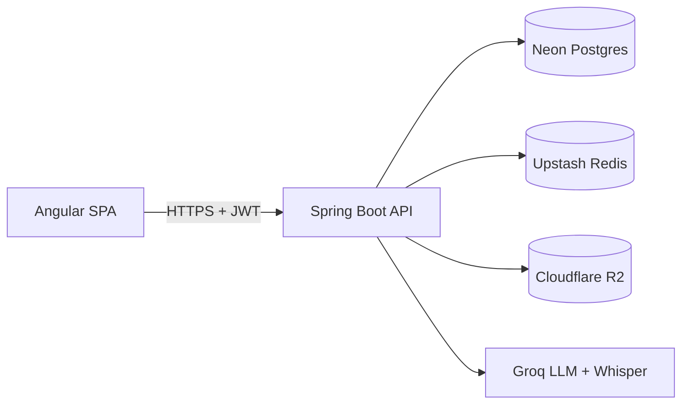

# AI-Powered Job/Interview Prep Tracker

Full-stack application (Spring Boot + Angular) that helps job seekers track applications, close resume-to-JD gaps with AI analysis, and rehearse interviews with AI-scored voice mock sessions.

**Live demo:** _link added after first deploy_
**Demo video:** _Loom link, 2-3 min, added before sharing with recruiters_

## Architecture at a Glance

Full architecture, sequence diagrams, and ADRs: [`architecture.md`](./architecture.md).
Complete schema/ER: [`database.md`](./database.md). API contracts: [`api-spec.md`](./api-spec.md).

## Feature Overview (Phase 1)
- **Application Tracker** — CRUD job applications with a defined status lifecycle (`system-spec.md` §7).
- **JD-to-Resume Gap Analyzer** — async AI comparison of a job description against your resume: missing keywords, tailored bullet suggestions.
- **Voice Mock Interview** — record an answer, get a transcript, a STAR-structure score, and filler-word/pace feedback.

Roadmap (not built in Phase 1, tracked for future work): Interview Question Predictor, Application Success Analytics, Salary Negotiation Simulator, Ghosting Detector.

## Tech Stack
Backend: Spring Boot (Java 21), PostgreSQL (Neon), Redis (Upstash), Cloudflare R2, Groq (LLM + Whisper).
Frontend: Angular (standalone components, Reactive Forms, RxJS-based state).
Infra: Docker, GitHub Actions, Render/Railway, Vercel/Netlify.

## Local Development Setup
Prerequisites: Docker, Docker Compose, Java 21, Node 20+.
```bash
git clone <repo>
cd job-tracker
cp .env.example .env   # fill in local values; no real API keys needed locally — see below
docker compose up      # backend + Postgres + Redis + WireMock (stubbed AI), all local
cd frontend && npm install && npm start
```
Local development uses WireMock in place of real Groq/Whisper calls (`docker-compose.yml`) — no API keys or cost required to run the app end-to-end locally. See [`deployment.md`](./deployment.md) §2-3 for the full environment/config reference.

## Testing
```bash
./mvnw test verify               # backend unit + Testcontainers integration
cd frontend && npm run test      # frontend unit
npm run e2e                      # Cypress, against docker-compose stack
```
Full test matrix and rationale: [`testing-strategy.md`](./testing-strategy.md).

## Documentation Map
| Document | Contents |
|---|---|
| `system-spec.md` | Source of truth — scope, requirements, user journeys, lifecycles, processing guarantees, DoD |
| `architecture.md` | Component diagram, durable job queue design, AI architecture, sequence diagrams, ADRs |
| `api-spec.md` | Every endpoint, request/response JSON, error catalog |
| `database.md` | Full schema, indexes, constraints, migration strategy |
| `security.md` | Threat model, OWASP mapping, auth detail, privacy/retention |
| `observability.md` | Logging, metrics (with exact formulas/sources), dashboards, alerts |
| `testing-strategy.md` | Test matrix, concrete test list per layer, including distributed-correctness tests |
| `deployment.md` | Environments, CI/CD pipeline, rollback, backup/DR, free-tier capacity modeling |
| `FINAL-AUDIT.md` | Severity-ranked findings from the adversarial architecture review, and what changed as a result |
| `interview-notes.md` | Discussion-oriented framing of key decisions — kept separate from the engineering specs, which state decisions neutrally |

This document set has been through one full adversarial architecture review (see `FINAL-AUDIT.md`) covering crash/restart behavior, concurrent requests, multi-instance deployment, and free-tier failure modes — several real bugs, not just missing documentation, were found and fixed, including a foreign-key gap that would have broken account deletion and a refresh-token race that could log users out unnecessarily.

## Local Development Note
The Docker image bundles `ffmpeg`/`ffprobe` for reliable audio duration/format validation (`architecture.md` §8) — no additional local setup needed beyond `docker compose up`.

## Pre-Demo Checklist
- [ ] Live URL working (cold start accepted — free-tier Render/Railway, noted in `deployment.md` §6).
- [ ] Architecture/ER/sequence diagrams render correctly on GitHub (Mermaid).
- [ ] Demo video recorded covering both AI features end-to-end.
- [ ] `system-spec.md` §11 production-readiness checklist fully checked.
