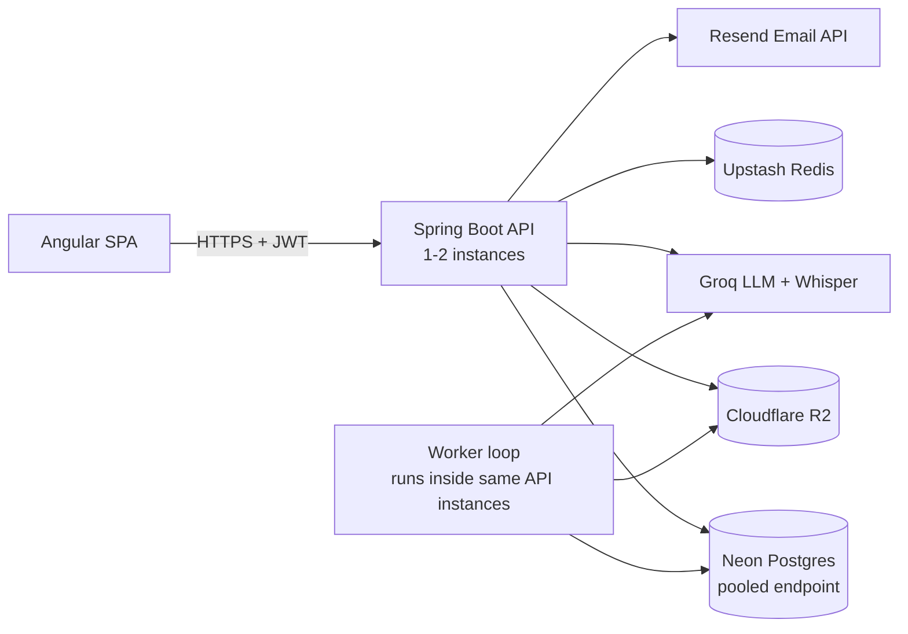

# architecture.md — System Architecture & Design Decisions
Supersedes all prior versions. Incorporates FINAL-AUDIT.md items #1, #2, #4, #5, #9, #12, #17, #21, #22, #23.

## 1. High-Level Component Diagram

The "worker" is a `@Scheduled` polling loop inside the same Spring Boot instances serving the API — not a separately deployed service. A dedicated worker fleet would require a message broker with no free-tier fit for this stack; a DB-backed queue with `FOR UPDATE SKIP LOCKED` gives durability and multi-instance safety using infrastructure already in use (Postgres). This is a deliberate simplicity choice appropriate to expected load (a few jobs per minute), not a shortcut — see §11 ADR-001.

## 2. Processing Guarantee — Stated Precisely
**The system provides at-least-once execution of external AI calls, and effectively-once persistence of final job state. It does not, and cannot, provide exactly-once processing end-to-end**, because no mechanism can atomically couple an HTTP call to Groq with a local Postgres commit — that is a fundamental limit of distributed systems, not a gap in this design. Concretely:
- If an instance crashes **after** a successful Groq/Whisper call but **before** the DB transaction that records the result commits, the job's lease expires, it is reclaimed, and the AI call **is made again**. This is at-least-once for the external side effect (bounded duplicate cost, see §3 cache-ordering fix, mitigated but not eliminated).
- The **persisted result**, however, is written via an `UPDATE` to a placeholder row created at job-submission time (database.md §2), never a fresh `INSERT` — so replaying the finalize step twice produces the same final row state both times (idempotent write). Final state is effectively-once even though the path to it may involve a repeated external call.
This distinction is stated once, here, and referenced (not restated) by system-spec.md and every other document — it is the single canonical description of the guarantee.

## 3. Durable Async Job Architecture
Table: `async_jobs` (database.md §2).

**Claim** (atomic across N instances):
```sql
UPDATE async_jobs
SET status='PROCESSING', locked_by=:instanceId, locked_until=now()+interval '5 minutes',
    processing_started_at=now(), attempt_count=attempt_count+1, updated_at=now()
WHERE id = (
  SELECT id FROM async_jobs
  WHERE status='QUEUED' AND available_at <= now()
  ORDER BY created_at LIMIT 1
  FOR UPDATE SKIP LOCKED
)
RETURNING *;
```
`FOR UPDATE SKIP LOCKED` under Postgres's default `READ COMMITTED` isolation is sufficient and deliberately used instead of `SERIALIZABLE` — the latter would only introduce serialization failures under contention with no correctness benefit for this claim pattern. Two instances polling simultaneously can never claim the same row: the second query simply skips the locked row.

**Lease duration vs. actual processing time**: the 5-minute lease is chosen as a large multiple of the worst-case bounded processing time (Resilience4j timeout+one retry: ≤~40s for Gap Analysis, ≤~50s for Voice Scoring, §6). Because processing is always bounded well under the lease window, **no heartbeat/lease-renewal mechanism is needed** — a lease can only expire early if the instance holding it has actually died, which is exactly the condition the sweep (below) exists to handle. Adding heartbeats would be complexity solving a problem that doesn't exist at this bound (rule against architecture astronautics).

**Finalize (success)**, in one transaction: `UPDATE` the pre-existing `gap_analysis_results`/`voice_sessions` placeholder row with the result, then `UPDATE async_jobs SET status='DONE', completed_at=now()`. Both statements commit together or not at all — there is no state where the result is saved but the job still shows QUEUED/PROCESSING, or vice versa.

**Finalize (failure)**: if `attempt_count < max_attempts`: `status='QUEUED'`, `available_at = now() + backoff(attempt_count)` (exponential, `10s * 2^(attempt_count-1)`, capped 300s). If `attempt_count >= max_attempts`: `status='FAILED'`, `last_error` set. If the finalize `UPDATE` itself throws (a transient DB error, distinct from an AI failure) the worker catches it per-job, logs `ERROR`, and takes no further action on that job — it is left `PROCESSING`, its lease expires naturally, and the sweep (below) requeues it. A DB hiccup during finalize never crashes the whole polling loop or silently drops the job.

**Stuck-job recovery** (crash/deploy mid-processing): a second `@Scheduled` sweep (every 60s, singleton-guarded, §5) —
```sql
UPDATE async_jobs SET status='QUEUED', available_at=now()
WHERE status='PROCESSING' AND locked_until < now();
```
An instance that died simply lets `locked_until` expire; no manual intervention, no distributed coordinator needed beyond the row itself.

**Graceful shutdown**: `server.shutdown=graceful`, 30s timeout-per-phase. On `ContextClosedEvent` the polling loop stops claiming new jobs; an already-claimed job either finishes within the window or its lease expires and the sweep reclaims it — never lost, never double-processed (the claim step is what prevents double-processing, not the shutdown handling).

## 4. Idempotency (job creation) — database.md §4 is the canonical design
Summarized here for architectural context only: a single atomic `INSERT` against `async_jobs` carrying `idempotency_key` + `request_fingerprint` is the entire mechanism (audit #6). No separate table, no check-then-write race, crash-safe by construction because there is exactly one durable write, not two.

## 5. Scheduled-Task Singleton (multi-instance safety)
Any `@Scheduled` method that must run once, not once-per-instance (stuck-job sweep, metrics aggregation, resume/R2 cleanup sweeps), wraps its body in a Postgres advisory lock (`pg_try_advisory_lock`/`pg_advisory_unlock`, distinct integer key per task name). Requires no extra infrastructure and is correct for any instance count.

## 6. AI Architecture (Groq LLM + Whisper)
- **Model config**: `llama-3.3-70b-versatile` (Gap Analysis + STAR scoring), `whisper-large-v3` (transcription). `model_used` stored per result.
- **Prompt management**: versioned text resources (`prompts/gap-analysis-v1.txt`, `prompts/star-scoring-v1.txt`), never inline strings; `prompt_version` stored per result.
- **Prompt-injection defense**: JD/resume text wrapped in an explicit `<untrusted_input>` block with a system instruction to treat its contents as data, never instructions, and to always respond only with the specified JSON. Realistic mitigation, not a claim of immunity — the residual risk is bounded because AI output is never used to trigger further privileged action, only rendered as display text (security.md §4).
- **Structured output validation**: every response parsed and validated against a fixed schema (api-spec.md §5/§6) via DTO deserialization + Bean Validation. Invalid/malformed JSON triggers exactly one retry with a stricter follow-up instruction; a second failure marks the job `FAILED` with `last_error='malformed-ai-response'`. The raw invalid response is logged (`WARN`, redacted per security.md §6), never persisted to the result table.
- **Token/context limits**: JD text and resume extracted text each truncated to 6,000 characters before prompting; `jd_truncated`/`resume_truncated` flags stored and surfaced to the UI.
- **Timeout/retry/circuit breaker**: Resilience4j — timeout 15s (LLM) / 20s (Whisper), retry 1x on timeout/5xx, circuit breaker opens at ≥50% failure rate over a 10-call sliding window, stays open 30s; while open, new job attempts fail fast to `FAILED` with `ai-service-unavailable` rather than queuing against a known-down dependency. Circuit-breaker state transitions are logged `WARN` and feed the `ai_provider_failure_rate` metric (observability.md §3).
- **Cache key includes the model, not just the prompt version** (audit #9): `sha256(promptVersion + modelName + jdTextNormalized + resumeContentHash)` — a model substitution without a prompt bump still invalidates stale cache entries correctly.
- **Cache-write-before-commit ordering** (bounds at-least-once duplicate cost, §2): on a cache miss, the sequence is Groq call → validate → **write to Redis cache** → open DB transaction → finalize. If a crash happens after the cache write but before the DB commit, the job's inevitable retry hits the now-populated cache instead of calling Groq a second time — this ordering is the concrete, bounded mitigation for the at-least-once duplicate-cost risk stated in §2, not a claim that it's eliminated (a simultaneous Redis outage at that exact moment would still allow a duplicate call — accepted residual risk given how rare that intersection is).
- **Per-user quotas & cost control**: security.md §7 (Redis, fail-closed).
- **Quality/regression evaluation** (not the same as correctness testing, audit #10): a separate, scheduled (weekly, not per-PR) eval job runs ~10 fixed golden JD/resume and question/transcript fixtures against the **real** Groq API, asserting loose properties reviewed by a human (e.g. "missingKeywords includes at least one of a known-missing skill set") — never an auto-blocking CI gate, since LLM output is non-deterministic and a hard content-match gate would be either trivial or flaky. `prompt_version`/`model_used` on every stored result make it possible to correlate a quality regression to a specific change (testing-strategy.md §6).

## 7. Gap Analyzer Algorithm
The LLM performs the JD-vs-resume diff directly against the fixed JSON schema (api-spec.md §5) rather than a hand-rolled keyword-extraction pipeline — deterministic parts (cache key, truncation, schema validation) are handled in Java; the semantic comparison is delegated to the LLM (ADR-005, §11).

## 8. Voice Mock Scoring
- Transcription: Whisper → transcript text.
- **Audio duration/format validation** (fixed per audit #12): `ffprobe` (bundled in the Docker image) is shelled out to for duration and container/codec detection — Apache Tika's audio metadata support is inconsistent across codecs and was rejected as unreliable for enforcing the 180s cap. A file `ffprobe` cannot parse is rejected outright as `400 invalid-audio`, independent of whether the upload's declared `Content-Type` looked valid.
- Filler words: regex word-boundary match against a fixed list (`um, uh, like, you know, sort of, kind of`), case-insensitive, computed in Java — deterministic, cheap, not LLM-dependent.
- Pace: `wordCount(transcript) / (ffprobe-reported duration seconds / 60)`.
- STAR score: one LLM call, same schema-validation/retry/versioning/cache-model-inclusion rules as §6.

## 9. File & Object Processing Safety (audit #5)
- **DOCX (zip-based) parsing**: Apache POI configured with `ZipSecureFile.setMinInflateRatio()` and an explicit max-uncompressed-size ceiling **before** any entry is read, specifically to reject decompression-bomb-style files (a small upload that would expand to gigabytes).
- **PDF parsing**: PDFBox `PDFTextStripper` (text extraction only — never rendering, never executing embedded JavaScript/actions, safe by construction since the API used has no execution surface).
- **Bounded execution**: both POI and PDFBox extraction run inside a dedicated bounded executor with a hard 10-second wall-clock timeout; a file that doesn't finish parsing in that window is killed and rejected as `400 invalid-file-type`, rather than risking a hung worker thread.
- **Extraction ceiling**: extracted text is capped at 20,000 characters at extraction time regardless of upload size, bounding downstream storage and LLM cost independent of the 5MB upload limit.
- **R2/DB write ordering, stated as a general rule** (audit #21): for any flow writing to both R2 and Postgres, the **R2 write always happens first** and must succeed before the referencing DB row is committed. The reverse order is never used, because it could leave a DB row pointing at an object that was never actually written. Applies identically to resume upload and voice-audio upload.
- **Object naming**: `users/{userId}/resumes/{resumeId}.{ext}`, `users/{userId}/voice/{sessionId}.{ext}`.
- **Access control**: R2 bucket is private; all reads are server-generated presigned GET URLs, 5-minute TTL (api-spec.md §4). No permanent public link ever exists.
- **Two independent cleanup mechanisms** (audit #2 — the original single "orphan by absence" sweep could never catch superseded resumes, since a superseded row is never absent):
  1. **Orphan-by-absence sweep** (weekly, singleton-guarded): lists R2 objects under known prefixes, deletes any with **no matching DB row at all**, older than 24h — catches uploads where the R2 write succeeded but the DB commit that should have followed never happened.
  2. **Superseded-resume sweep** (daily, singleton-guarded): finds `resumes` rows with `is_active=false AND pending_deletion_at < now() - 24h AND deleted_at IS NULL` (database.md §2), deletes the R2 object, then sets `deleted_at=now()`. This is the mechanism that actually cleans up a replaced resume's old file — the orphan sweep alone never would have.

## 10. Account Deletion Cascade
1. `DELETE /account` (no idempotency key needed — naturally idempotent by state-check, database.md §4) → `users.status='PENDING_DELETION'`, `deletion_requested_at=now()`, all refresh token families revoked (immediate logout everywhere).
2. **While `PENDING_DELETION`** (audit #11): login remains allowed (so the user can reach the cancel-deletion screen); every functional endpoint except `/account/*` returns `403 account-pending-deletion` with the effective deletion date in `detail`, enforced by a single base-controller check rather than per-endpoint duplication.
3. 30-day grace window: `POST /account/cancel-deletion` reverts to `ACTIVE` if within the window.
4. After the window, a scheduled job (singleton-guarded): deletes all R2 objects under `users/{userId}/*`, hard-deletes `applications`/`resumes`/`async_jobs` (cascades verified FK-safe end-to-end, database.md §3), anonymizes `audit_log` rows (`user_id=NULL`, PII fields stripped from `before_json`/`after_json`, `entity_type`/`action`/`created_at` retained for aggregate stats), sets `users.status='DELETED'`, clears `email`/`name`/`password_hash`.

## 11. Frontend Architecture (Angular) — Correctness-Critical Behaviors
- **Standalone components**, feature-area lazy-loaded routes (`auth/`, `applications/`, `gap-analysis/`, `voice-mock/`, `account/`, `admin/`).
- **State management**: plain services with RxJS `BehaviorSubject`s per feature area — NgRx deliberately not introduced; the state graph doesn't have cross-cutting complexity NgRx solves for, and adding it would be unjustified complexity.
- **Single-flight token refresh** (fixes audit #1, the concurrent-401 breach-detection bug): `authInterceptor` maintains one shared in-flight refresh `Observable`. The first `401` triggers exactly one `/auth/refresh` call; every other request that also receives a `401` while that refresh is in flight subscribes to the **same** observable instead of issuing its own refresh call, then retries with the resulting token once it resolves. Combined with the backend's 10-second post-rotation grace window (security.md §2), this eliminates the false-positive reuse-detection lockout from concurrent requests — the frontend fix removes the race in the common case, the backend grace window is defense-in-depth for the residual case (e.g. two tabs, not just two concurrent requests in one tab).
- **Guards**: `authGuard`, `verifiedGuard`, `adminGuard` — functional guards, unit-tested for both allow and deny paths.
- **Interceptors**: `authInterceptor` (above), `correlationIdInterceptor`, `errorInterceptor` (RFC 7807 → in-app notification mapping).
- **Forms**: Reactive Forms, validators mirrored from backend Bean Validation rules for fast feedback — server is always re-validated regardless (rule: never trust client validation alone).
- **Polling lifecycle** (fixes audit #17): 2-second interval, capped at 30 polls (60s) before switching to a manual-refresh state; subscription torn down via `takeUntilDestroyed()` so navigating away stops polling immediately rather than leaking a background interval; a poll failure attributable to network loss (not a 4xx/5xx from the server) pauses the interval and resumes on the browser `online` event rather than continuing to fail every 2 seconds while offline.
- **Async UI states**: every async-backed view has loading / error / empty states — never a blank screen (system-spec.md §9 has the full UX contract).
- **Accessibility/responsive**: WCAG 2.1 AA, mobile-first breakpoints — verified automatically (testing-strategy.md §5).

## 12. Backend Package Boundaries
```
com.jobtracker
 ├─ auth/ applications/ resumes/ gapanalysis/ voicemock/
 ├─ jobqueue/   (async_jobs claim/sweep/backoff — shared, no domain dependency)
 ├─ ai/         (Groq/Whisper clients, Resilience4j config — no domain dependency)
 ├─ audit/      (AOP aspect writing audit_log)
 ├─ metrics/    (hourly aggregation job, admin stats read endpoint)
 └─ common/     (RFC 7807 handling, correlation-id filter, security headers, SafeLogRedactor)
```
`jobqueue/` and `ai/` having no dependency on domain packages is enforced by an ArchUnit test in CI, not just asserted. DTOs and JPA entities are never the same class; MapStruct mappers sit at each controller boundary.

## 13. Architecture Decision Records
**ADR-001**: DB-backed job queue instead of a message broker — no free-tier broker fits this stack at this workload; `FOR UPDATE SKIP LOCKED` gives correctness without new infrastructure. Tradeoff: not suited to high throughput, an explicit and accepted scaling limit.
**ADR-002**: Short-polling instead of WebSocket for job status — 2+ backend instances on Render free tier have no shared session affinity or pub/sub wired up; a WebSocket client could connect to an instance that never learns a job finished. Revisit only if a shared pub/sub (Upstash Redis does support this) is deliberately added later.
**ADR-003**: JWT access token + rotating, DB-backed opaque refresh token — access token stateless for the hot path; refresh token must be revocable (logout, breach detection), which a pure JWT can't do before its own expiry.
**ADR-004**: Redis fails open for cache, closed for rate-limit/quota — a cache miss costs latency; a rate-limit/quota bypass during a Redis outage costs real, unbounded money against a metered LLM API. Different failure costs justify different failure modes.
**ADR-005**: LLM performs the JD/resume diff directly rather than custom keyword-extraction NLP — a hand-rolled pipeline would be more code and lower quality with no correctness benefit.
**ADR-006** (new): 10-second refresh-token grace window plus frontend single-flight refresh, rather than either alone — the frontend fix handles the common single-tab race; the backend grace window handles the residual multi-tab/multi-device race that no frontend-only fix can cover, since the two tabs don't share JS state.
